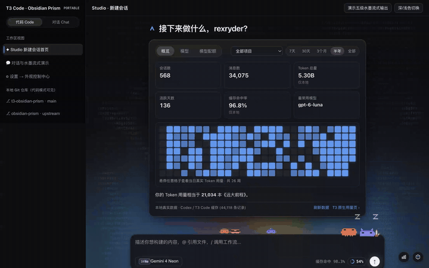
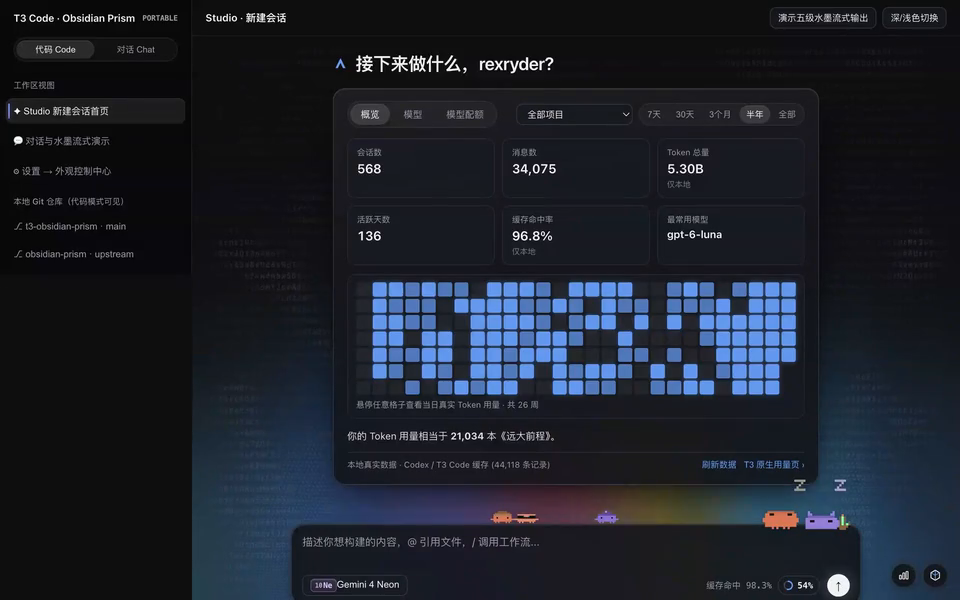
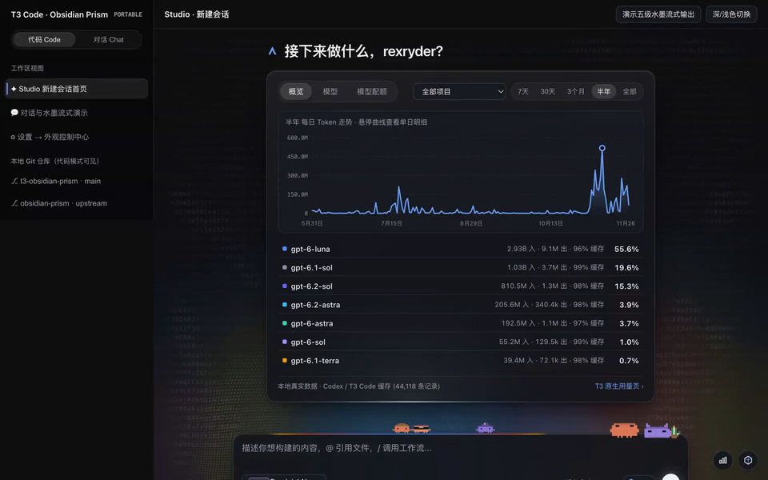
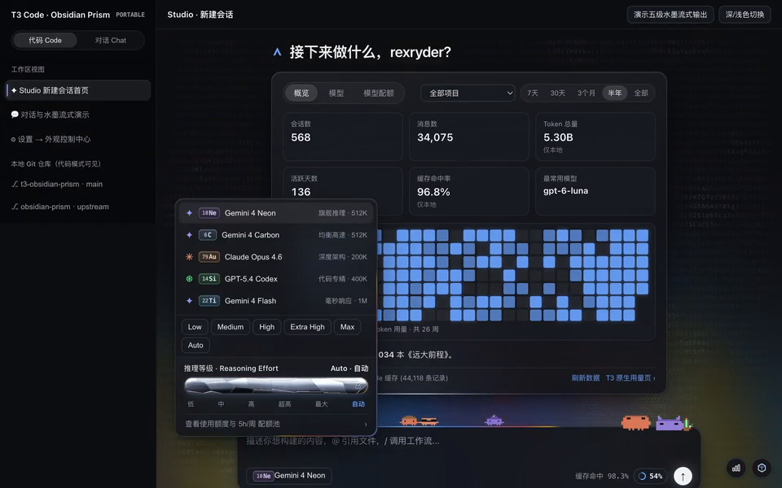
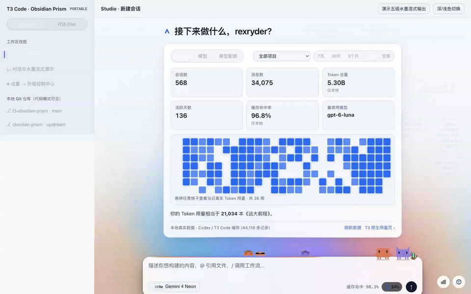

<div align="center">

# T3 Prism Optics

**Zero-Source-Modification Optical UI, WebGL2 Motion, Reasoning Effort Slider & Codex/T3 Telemetry Suite for T3 Code Desktop**

[](./LICENSE)
[](https://nodejs.org/)
[](#architecture)
[-141418.svg)](#quick-start)

**English** | **[简体中文](./README.zh-CN.md)**

*An independent, portable T3 Code Desktop plugin powered by Chrome DevTools Protocol (CDP) hot-injection — bringing smoked obsidian palettes, WebGL2 ASCII ripple horizons, 1px GPU near-field prism rims, 5-stage `CSS.highlights` ink streaming, a flowing cosmic reasoning effort slider, a 512K 3D shallow-water context vial, a 6-month Codex + T3 usage heatmap dashboard, pixel companions, and a functional `Code | Chat` workspace switch to T3 Code without touching a single line of T3 Code's source or binary.*

<br/>



<sub>🎬 <a href="assets/demo-preview.mp4">Watch crisp 960p H.264 MP4 preview (466 KB)</a> · Every screenshot below is rendered from the exact production CDP bundle.</sub>

</div>

---

## Why T3 Prism Optics?

Most community [T3 Code](https://github.com/pingdotgg/t3code) customizations are static JSON/CSS color themes. **T3 Prism Optics** goes far beyond static color tokens by attaching a **zero-dependency, localhost-only CDP hot-injection runtime** directly to T3 Code Desktop (Electron):

- **Zero Source or Binary Patching** — Never modifies `T3 Code.app` / `app.asar` or forks T3 Code's codebase. Official T3 Code updates install cleanly without rebasing or breaking.
- **Zero External npm Dependencies** — Uses Node.js >= 22 built-in `fetch`, `WebSocket`, and `fs`. Clone and run immediately.
- **Instant Hot-Reload & Zero-Residue Removal** — Edit CSS/JS and see changes live in open T3 Code windows; run `npm run remove` to strip every injected DOM node, canvas, and style cleanly.
- **100% Local & Private** — Connects exclusively to `127.0.0.1` CDP and reads local `~/.t3/userdata/` & `~/.codex/sessions/` files on-device. Zero cloud telemetry, zero external requests, and distributed bundles never bake in personal data.

---

## Visual Showcase

<table>
  <tr>
    <td width="50%">
      
      <p align="center"><b>Studio 6-Month Overview &amp; 26-Week Heatmap</b><br/><sub>Real local Codex + T3 Code history (7d / 30d / 3m / 6m / All), project filter, cache hit rate &amp; equivalent books written.</sub></p>
    </td>
    <td width="50%">
      
      <p align="center"><b>Daily Token Area Chart &amp; Model Breakdown</b><br/><sub>Hoverable SVG trend curve + per-model input/output tokens, prompt cache hit ratio, and share percentage.</sub></p>
    </td>
  </tr>
  <tr>
    <td width="50%">
      
      <p align="center"><b>Periodic Keycaps, Cosmic Effort Slider &amp; Crystal Bar</b><br/><sub><code>[10Ne]</code> / <code>[79Au]</code> / <code>[14Si]</code> keycaps, bidirectional sync with T3's native effort menu, and WebGL2 cut-crystal bar for <code>Auto</code>.</sub></p>
    </td>
    <td width="50%">
      
      <p align="center"><b>Dual-Mode Optics (Crystal Light &amp; Alabaster)</b><br/><sub>4 calibrated palettes (Deep Space Obsidian, Warm Charcoal, Crystal Light, Alabaster Light), 5 accent tones &amp; 3 corner presets.</sub></p>
    </td>
  </tr>
</table>

---

## Complete Feature Suite

### 1. Optical Surfaces & GPU Shaders
- **4 Calibrated Palettes + 5 Accents + 3 Corner Presets**: Deep Space Obsidian (`#09090B`/`#0E0E11`), Warm Charcoal (`#10100F`/`#141413`), Crystal Light (`#E8EEF6`/`#F4F7FB`), and Alabaster Light (`#EBE6DC`/`#F6F4EE`), paired with Prism Follow / Cobalt / Iris / Amber / Titanium Mono accents and Sharp / Balanced / Soft radii.
- **WebGL2 Interactive ASCII Ripple Matrix & Horizon Glow** (`engines/ripple-core.js`): Pointer movement excites physical ASCII ripples and 4-band prism spectra; sending a prompt launches a liftoff wave; automatically drops to **0 FPS** when idle.
- **1px GPU Near-Field Pointer Prism Rim** (`engines/prism-rim-canvas.js`): Sub-pixel refractive highlight tracking your cursor around the composer and popovers, automatically releasing WebGL memory on mouse leave.
- **Zero-Reflow 5-Stage Velvet Ink Streaming** (`src/t3-stream-ink.js`): Uses the native CSS Custom Highlight API (`CSS.highlights` `t3-stream-f0`..`f4`) to feather newly streamed tokens smoothly (`18% → 42% → 66% → 85% → 95%`) without wrapping text in `<span>` nodes or causing layout reflow, while overriding T3's coarse `600ms` whole-block fade-in.

### 2. Model Picker & Reasoning Effort Controls
- **Periodic-Table Graphite Keycap Badges** (`src/t3-model-controls.js`): Assigns tactile element keycaps (`[10Ne]`, `[6C]`, `[18Ar]`, `[79Au]`, `[78Pt]`, `[14Si]`, `[22Ti]`) plus brand marks across T3 Code's model selector.
- **Bidirectional Flowing Cosmic Effort Slider**: Reads and controls T3 Code's native `[data-model-picker-effort]` levels dynamically with a 4-layer GPU-accelerated nebula sweep (`t3opCesSweep`), 28 drifting stardust particles (`t3opCesStarDrift`), spring-damped luminous thumb, and value bloom.
- **WebGL2 Cut-Crystal Prism Bar** (`engines/crystal-prism-core.js`): Automatically morphs the track into a real-time refractive crystal prism bar when selecting `Auto` / `Adaptive`.

### 3. 512K 3D Glass Vial & Studio 3-Tab Analytics Dashboard
- **Composer HUD + 512K 3D Graduated Glass Vial** (`engines/vial-core.js` + `src/t3-telemetry-studio.js`): 24-node shallow-water wave physics capsule displaying real context occupancy, interactive layer hover sloshing, verified model telemetry, and live `5h` / `7d` quota pools.
- **Studio 3-Tab Dashboard (`Overview` / `Models` / `Model Quotas`)**:
  - Parses local T3 Code usage caches (`~/.t3/userdata/usage-scan-cache-v*.json`), T3 SQLite project registry (`statev2.sqlite`), and local Codex session JSONL logs (`~/.codex/sessions/**/*.jsonl`) with deduplication.
  - Supports **5 time scales** (`7d` / `30d` / `3m` / `6m` / `All`), per-project filtering, 6 KPI cards, a 26-week 7-row activity heatmap, an interactive SVG area+line daily token trend chart, live Codex rate-limit windows, a floating bottom-right modal trigger (accessible from any thread), and a 1-click jump to T3 Code's native `/usage` view.

### 4. Pixel Companions & Productive Workbench
- **Perched Pixel Companions** (`engines/dual-mascot-rig.js`): Dual / Stackable Minis / Quad / Quad+Minis pixel mascots perched on top of the composer that track your cursor, reflect the 1px prism rim color, react to streaming, and support drag-and-stack physics.
- **Functional `Code | Chat` Workspace Mode Switch** (`src/t3-workbench-settings.js`): Mounted cleanly at the top of T3 Code's sidebar. Switching to **Chat** collapses project folder rows, automatically closes open terminal and right-side diff panels, centers the conversation column (`740px`), and adds a quick `✦ New Pure Chat` button + header mode indicator.
- **Long Codeblock & Reply Folding + Searchable Outline Rail**: Sticky frosted code headers with fold/expand toggles, long assistant reply collapsing, and a floating searchable turn-outline navigator.
- **Smooth Pixel Caret** (`engines/smooth-caret.js`) + **Inline Appearance Control Center** (embedded into T3 Settings and accessible via a floating quick drawer with bidirectional `config.json` persistence).

---

## Upstream Attribution & What's Unique for T3 Code

**T3 Prism Optics** is an independent derivative port for **T3 Code Desktop** built upon the zero-coupling optical rendering engines of **[RMvdesi/obsidian-prism](https://github.com/RMvdesi/obsidian-prism)** (`GPL-3.0-only`). Full credit and legal notices are preserved in [`LICENSE`](./LICENSE), [`NOTICE`](./NOTICE), [`THIRD_PARTY_NOTICES.md`](./THIRD_PARTY_NOTICES.md), and inside the in-app Appearance Control Center.

| Layer | Source / Origin | What It Does |
| :--- | :--- | :--- |
| **Optical & Physics Engines** (`engines/*.js`) | Reused from **[RMvdesi/obsidian-prism](https://github.com/RMvdesi/obsidian-prism)** (`GPL-3.0-only`) & its MIT upstream credits (`0DNANCY/agy-claude-style`, `ATtacK030130/antigrative-dashboard`, `LLYSH-HANNARI/antigravity-Codex-Claude-effort-slider`, `Nwflower/dsh-claude-style`, `Microqian2th/dsh-codex-effort-slider`, `mobius/dsh-performance-slider`, `claudenoshujin/claude-web`, `wp3171216237/dsh-TUI`) | Zero-DOM-coupling WebGL2 ASCII ripple field, 1px GPU prism rim, WebGL2 cut-crystal bar, 24-node shallow-water 3D glass vial, pixel mascot rig, smooth caret, damped spring motion, and animated icon primitives. |
| **Zero-Dependency CDP Hot-Injection Runtime** (`lib/cdp.js`, `lib/inject.js`, `lib/remove.js`, `lib/install.cjs`) | **Original for `t3-prism-optics`** | Node >= 22 native `fetch`/`WebSocket` CDP client, `DevToolsActivePort` discovery for Electron `t3code-v2`, single-file deterministic bundle compiler, `--watch` auto-reinject & file hot-reload daemon, bidirectional `__t3OpSetting` / `__t3OpTelemetryCall` bindings, and portable `~/.t3/plugins/t3-prism-optics` installer. |
| **Local T3 Code + Codex Telemetry Aggregator** (`lib/telemetry.js`) | **Original for `t3-prism-optics`** | Deduplicated parser combining `~/.t3/userdata/usage-scan-cache-v*.json`, `~/.t3/userdata/statev2.sqlite`, and `~/.codex/sessions/**/*.jsonl` (including live 5h/7d rate-limit windows & multi-month history). |
| **T3 Code Native DOM & Workbench Suite** (`src/t3-*.js`, `src/t3-style.css`) | **Original for `t3-prism-optics`** | Built against T3 Code's stable `data-*` selectors: 5-stage `CSS.highlights` ink streaming, live bidirectional `[data-model-picker-effort]` sync with 4-layer flowing cosmic slider, 3-tab 5-scale Studio dashboard, functional `Code | Chat` workspace switch, code/reply folding, searchable outline rail, and Appearance Control Center. |

> **Non-Affiliation Disclaimer**: T3 Prism Optics is an independent community project. It is **not** affiliated with or endorsed by RMvdesi / Obsidian Prism, Ping Labs / T3 Code, Google LLC, OpenAI, or Anthropic.

---

## Quick Start

### Prerequisites
- **Node.js >= 22** (uses built-in `fetch` and `WebSocket`, zero `npm install` needed)
- **T3 Code Desktop** (macOS / Linux / Windows Electron app)

### 1. Clone & Try the Interactive Browser Demo (No T3 Restart Needed)

```bash
git clone https://github.com/rexwhg/t3-prism-optics.git
cd t3-prism-optics

# Run unit tests (verify bundle compilation, telemetry aggregation & installer)
npm test

# Launch the interactive local demo using the exact production CDP bundle
npm run demo
```

### 2. Install as a Standalone Portable Plugin

```bash
# Installs cleanly into ~/.t3/plugins/t3-prism-optics (preserves config.json on upgrades)
npm run install:plugin
```

### 3. Launch T3 Code with Local CDP & Attach Hot-Injection

T3 Code Desktop enables local loopback CDP (`127.0.0.1`, ephemeral port written to `DevToolsActivePort`) when started with `--remote-debugging-port=0`:

```bash
# macOS: quit T3 Code completely (Cmd+Q), then launch with local CDP:
open -a "T3 Code (Beta)" --args --remote-debugging-port=0
# (or double-click ~/.t3/plugins/t3-prism-optics/launch-t3-with-prism.command)

# One-shot hot-inject into all open T3 Code windows:
npm run inject

# Or start the background watcher for auto-reinject on reloads & instant hot-reload:
npm run watch
```

### 4. Clean Removal & Uninstall

```bash
# Strip all injected styles, canvases, and DOM nodes from live T3 Code windows + stop watcher
npm run remove

# Remove the portable plugin folder from ~/.t3/plugins/t3-prism-optics
npm run uninstall:plugin
```

---

## CLI Reference

| Command | Description |
| :--- | :--- |
| `npm run inject` | One-shot CDP hot-injection into all open T3 Code windows |
| `npm run watch` | Persistent daemon: auto-injects new/reloaded windows, hot-reloads `src/` & `config.json`, syncs live telemetry |
| `npm run remove` | Stops watcher daemon and cleanly strips all injected DOM/CSS/WebGL resources |
| `npm run build:bundle` | Compiles deterministic privacy-clean single-file `dist/t3-prism-optics.bundle.js` |
| `npm run install:plugin` | Installs/upgrades portable bundle + macOS launcher in `~/.t3/plugins/t3-prism-optics` |
| `npm run uninstall:plugin` | Stops watcher and deletes `~/.t3/plugins/t3-prism-optics` |
| `npm run status` | Prints JSON status of installation, bundle hash, and discovered T3 Code CDP port |
| `npm run launch:t3` | Prints launch instructions (pass `-- --spawn` to spawn T3 Code with `--remote-debugging-port=0`) |
| `npm run demo` | Starts local demo harness (`http://127.0.0.1:4179`) exercising exact T3 Code DOM selectors |
| `npm test` | Runs Node native test suite (`test/plugin.test.mjs`) |

Explicit CDP port override:
```bash
node lib/inject.js --port 9222
# or
T3_PRISM_CDP_PORT=9222 npm run watch
```

---

## Architecture

```text
t3-prism-optics/
├── engines/                       # Zero-coupling optical & physics engines (from RMvdesi/obsidian-prism, GPL-3.0)
│   ├── ripple-core.js             # WebGL2 ASCII character ripple matrix & horizon glow
│   ├── prism-rim-canvas.js        # 1px GPU near-field pointer prism rim
│   ├── crystal-prism-core.js      # WebGL2 cut-crystal refractive bar for Auto effort
│   ├── vial-core.js               # 24-node shallow-water 3D graduated glass vial
│   ├── dual-mascot-rig.js         # Perched pixel companion rig & stackable mini ecology
│   ├── motion-engine.js           # 4-tier damped spring choreography
│   ├── animated-icons.js          # Micro-animated optical icons
│   └── smooth-caret.js            # Sub-pixel smooth editor caret
├── src/                           # Original T3 Code runtime, DOM adapters & smoked obsidian CSS
│   ├── t3-config.js               # Config schema, validators, localStorage & CDP bidirectional sync
│   ├── t3-stream-ink.js           # Zero-reflow 5-stage CSS.highlights ink streaming
│   ├── t3-optics-host.js          # Lifecycle host for WebGL2 ripples, prism rim, mascots & caret
│   ├── t3-model-controls.js       # Periodic keycaps, flowing cosmic slider & native effort sync
│   ├── t3-telemetry-studio.js     # Composer HUD, 512K vial popover & 3-tab Studio analytics dashboard
│   ├── t3-workbench-settings.js   # Code | Chat workspace switch, folds, outline rail & Control Center
│   ├── t3-runtime.js              # Idempotent orchestrator (window.__t3ObsidianPrism) & lossless destroy()
│   └── t3-style.css               # 4 palettes, 5 accents, 3 corners, flowing slider & Studio layout
├── lib/                           # Zero-dependency Node >= 22 CDP, telemetry & installer layer
│   ├── cdp.js                     # Bundle compiler, DevToolsActivePort discovery & native WebSocket CDP client
│   ├── telemetry.js               # Local T3 Code + Codex session JSONL & SQLite telemetry collector
│   ├── inject.js                  # One-shot & --watch hot-reload daemon
│   ├── remove.js                  # Zero-residue DOM/style/daemon remover
│   └── install.cjs                # Portable ~/.t3/plugins/t3-prism-optics installer
├── demo/                          # Self-contained local browser harness using T3 Code selectors
├── test/                          # Node built-in test runner suite (node:test)
├── assets/                        # Lightweight showcase GIF, MP4 & screenshots
├── LICENSE                        # GNU General Public License v3.0 (GPL-3.0-only)
├── NOTICE                         # Derivative modification notice + full upstream NOTICE
└── THIRD_PARTY_NOTICES.md         # Complete upstream MIT & inspiration credits
```

---

## Frequently Asked Questions (FAQ)

<details>
<summary><b>How is T3 Prism Optics different from regular T3 Code themes?</b></summary>

T3 Code's built-in theme loader supports static JSON color tokens and CSS rules. **T3 Prism Optics** attaches an optional, non-destructive JavaScript + WebGL2 optical runtime over local Electron CDP so you get real-time GPU ASCII ripples, 1px pointer-tracking prism borders, `CSS.highlights` per-token ink feathering, a bidirectional animated reasoning effort slider, a 3D physics context vial, a 6-month Codex + T3 Code usage heatmap dashboard, and a functional `Code | Chat` workspace switch — none of which are possible with static CSS alone.
</details>

<details>
<summary><b>Does it modify T3 Code's app bundle or break automatic updates?</b></summary>

No. It never touches `/Applications/T3 Code.app`, `app.asar`, or T3 Code's source files. Everything runs dynamically in memory via Electron's local DevTools protocol and removes cleanly with `npm run remove`.
</details>

<details>
<summary><b>Is any telemetry, prompt content, or usage data sent over the network?</b></summary>

Never. `lib/telemetry.js` reads only local cache/session files (`~/.t3/userdata/` and `~/.codex/sessions/`) to render your private Studio dashboard inside your own T3 Code window via `127.0.0.1` loopback CDP. `npm run build:bundle` and `npm run install:plugin` explicitly pass `includeLocalTelemetry: false` so static bundles never contain personal data.
</details>

<details>
<summary><b>Can T3 Code send one prompt to multiple models (e.g., Gemini + GPT) at the same time?</b></summary>

Yes — that is a **native T3 Code feature** in draft/new threads: hold `Shift` and click multiple models in T3 Code's model picker to fan out to multiple models simultaneously. T3 Prism Optics enhances the model picker UI and reasoning effort controls while preserving T3 Code's native multi-model selection.
</details>

<details>
<summary><b>Does this project fork RMvdesi/obsidian-prism?</b></summary>

No — because `RMvdesi/obsidian-prism` targets Antigravity IDE whereas this project targets **T3 Code Desktop** with an entirely different Electron/DOM/telemetry/CDP architecture, `t3-prism-optics` is maintained as a standalone derivative repository under **GPL-3.0-only**, preserving all upstream licenses, `NOTICE` Section 7 attribution, and `THIRD_PARTY_NOTICES.md`.
</details>

---

## License

This project is licensed under the **GNU General Public License v3.0 (`GPL-3.0-only`)** — see [`LICENSE`](./LICENSE), [`NOTICE`](./NOTICE), and [`THIRD_PARTY_NOTICES.md`](./THIRD_PARTY_NOTICES.md) for full terms, derivative obligations, and upstream attributions.

---

<details>
<summary><sub>Search &amp; Discovery Keywords (EN / 中文)</sub></summary>

<sub>T3 Code theme · T3 Code plugin · T3 Code UI · T3 Code custom theme · T3 Code optical UI · Obsidian Prism for T3 Code · Electron CDP hot injection · WebGL2 ASCII ripple · T3 Code reasoning effort slider · T3 Code Codex usage heatmap · 512K context window vial · T3 Code Chat mode · T3 Code 主题 · T3 Code 插件 · T3 Code 美化 · 黑曜棱镜 T3 适配 · Codex 用量热力图 · 推理等级星空滑块 · 零源码侵入热注入</sub>

</details>
