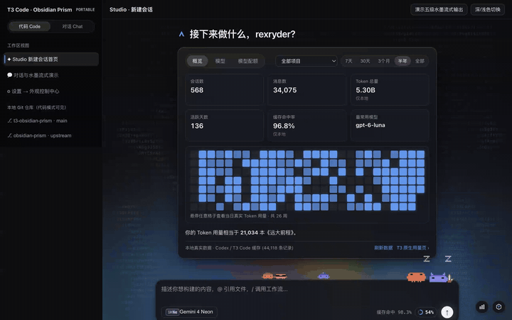
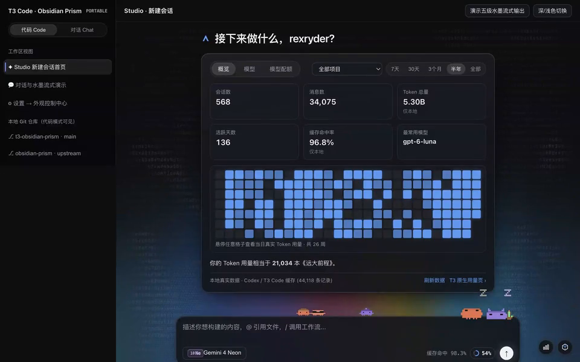
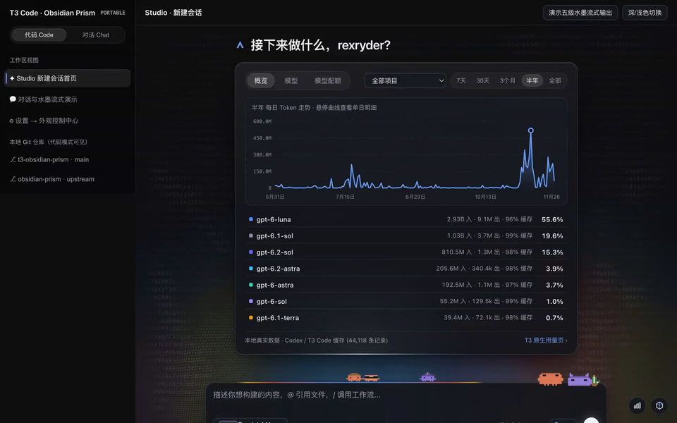
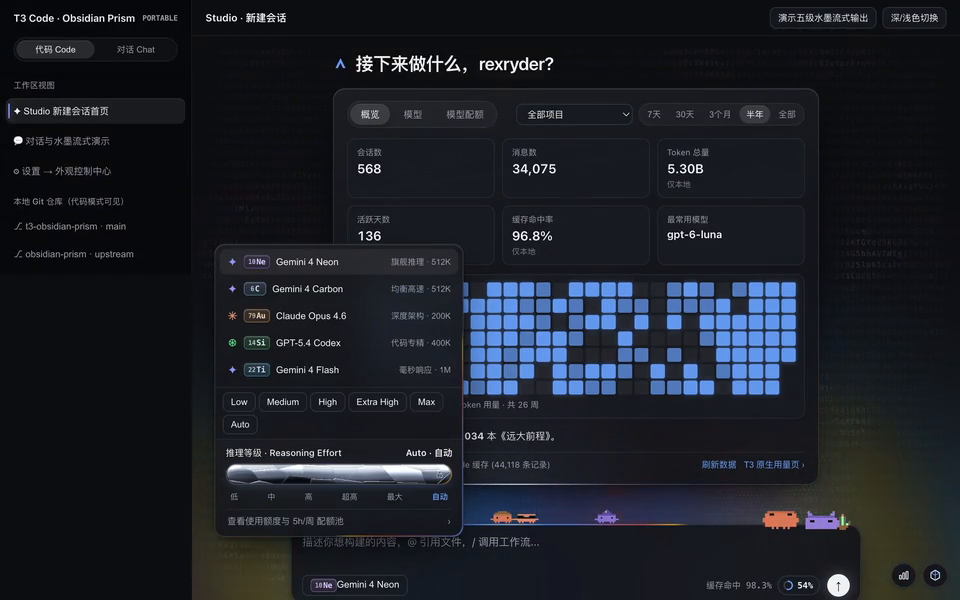
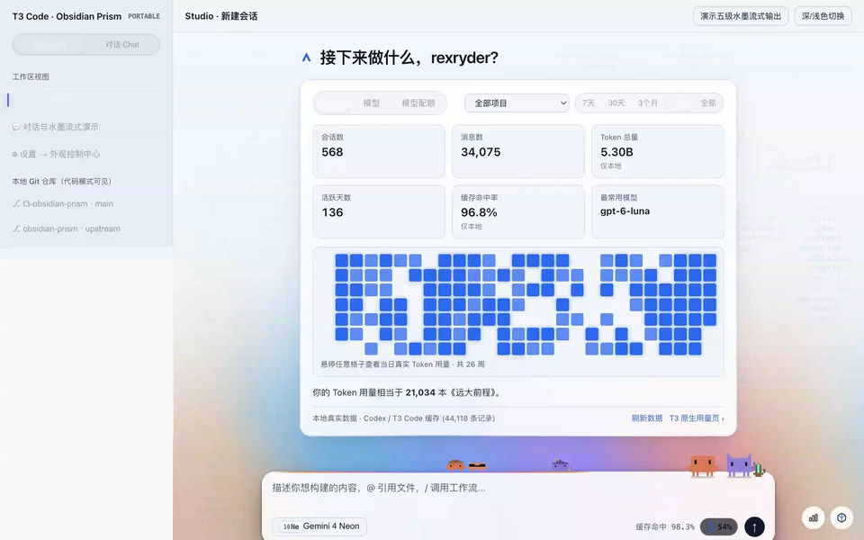

<div align="center">

# T3 Prism Optics

**零源码侵入的 T3 Code 桌面端光学材质、WebGL2 动效、宇宙星空推理滑块与 Codex/T3 半年遥测看板插件**

[](./LICENSE)
[](https://nodejs.org/)
[](#项目结构)
[-141418.svg)](#快速开始)

**[English](./README.md)** | **简体中文**

*面向 **T3 Code Desktop** 打造的独立便携光学 UI 与遥测增强插件，基于上游 [RMvdesi/obsidian-prism](https://github.com/RMvdesi/obsidian-prism)（GPL-3.0）零耦合光学引擎移植并深度重构。通过 Electron 本地 CDP 热注入，在不修改 T3 Code 任何一行源码与安装包的前提下，带来深空黑曜/昼景冷晶四套色板、WebGL2 ASCII 字符波纹、1px GPU 指针棱镜光边、五级 `CSS.highlights` 水墨流式渐显、双向联动的宇宙星空推理等级滑块、512K 3D 玻璃大试管、Codex + T3 真实半年用量热力图看板、输入框像素伙伴叠叠乐以及 `代码 Code | 对话 Chat` 双模式工作区切换。*

<br/>



<sub>🎬 <a href="assets/demo-preview.mp4">观看高清 960p H.264 MP4 演示视频（466 KB）</a> · 下方所有截图均由生产级 CDP 单文件包实时渲染生成。</sub>

</div>

---

## 为什么选择 T3 Prism Optics？

T3 Code 原生主题仅支持静态 JSON 配色与基础 CSS 变量，而 **T3 Prism Optics** 通过 **零外部依赖、仅限本机回环（`127.0.0.1`）的 CDP 热注入运行时**，为 T3 Code 桌面端带来完整的动态光学与生产力体验：

- **零源码侵入、官方升级无痛兼容**：不修改 `T3 Code.app` / `app.asar`，也不需要维护 T3 Code 源码 fork；官方版本更新后直接运行注入即可生效。
- **零外部 npm 依赖**：直接基于 Node.js >= 22 原生 `fetch`、`WebSocket` 与 `fs` 实现，克隆即可运行，无需 `npm install`。
- **实时热更新与零残留卸载**：`npm run watch` 支持源码与配置改动毫秒级热刷新；`npm run remove` 一键无痕清除全部注入样式、Canvas 与 DOM 节点。
- **100% 本机隐私安全**：仅连接本机 `127.0.0.1` CDP 端口并只读解析本地 `~/.t3/userdata/` 与 `~/.codex/sessions/` 数据，零云端上报、零外部网络请求；构建出的分发包强制剥离个人遥测数据。

---

## 视觉效果一览

<table>
  <tr>
    <td width="50%">
      
      <p align="center"><b>Studio 半年概览与 26 周活跃热力图</b><br/><sub>直连本地真实 Codex + T3 Code 用量历史，支持 7天 / 30天 / 3个月 / 半年 / 全部 五档切换与项目筛选。</sub></p>
    </td>
    <td width="50%">
      
      <p align="center"><b>每日 Token 走势曲线与模型明细</b><br/><sub>可悬停 SVG 面积折线图，按模型展示输入/输出 Token、缓存命中率与占比。</sub></p>
    </td>
  </tr>
  <tr>
    <td width="50%">
      
      <p align="center"><b>元素周期表键帽、星空滑块与切工水晶条</b><br/><sub><code>[10Ne]</code> / <code>[79Au]</code> / <code>[14Si]</code> 微键帽，双向同步 T3 原生推理档位，切至 <code>Auto</code> 自动变身 WebGL2 切工水晶条。</sub></p>
    </td>
    <td width="50%">
      
      <p align="center"><b>双模光学材质（白昼冷晶 / 暖白画册）</b><br/><sub>四套双模色板（深空黑曜 / 暖炭玄岩 / 白昼冷晶 / 暖白画册）、5 种工业强调色与 3 档圆角。</sub></p>
    </td>
  </tr>
</table>

---

## 核心功能矩阵

### 1. 光学背景、指针棱镜与零重排水墨流式
- **四套双模材质色板 + 5 种强调色 + 3 档圆角**：深空黑曜（`#09090B`/`#0E0E11`）、暖炭玄岩（`#10100F`/`#141413`）、白昼冷晶（`#E8EEF6`/`#F4F7FB`）、暖白画册（`#EBE6DC`/`#F6F4EE`），强调色支持跟随棱镜 / 钴蓝 / 鸢尾紫 / 琥珀 / 银钛。
- **WebGL2 全屏交互式 ASCII 字符波纹矩阵 + 地平线极光**（`engines/ripple-core.js`）：鼠标滑过激发物理涟漪与四色棱镜光谱，发送消息触发升空波纹，空闲自动 `0fps` 休眠释放 GPU。
- **1px GPU 近场指针棱镜光边**（`engines/prism-rim-canvas.js`）：紧贴输入框与浮窗圆角的 1px 动态光斑折射，移开后自动释放 Canvas 显存。
- **零重排五级水墨流式渐显**（`src/t3-stream-ink.js`）：基于浏览器原生 `CSS.highlights`（`t3-stream-f0`..`f4`）实现新输出字符 `18% → 42% → 66% → 85% → 95%` 丝滑浮现，不插入任何包裹 `<span>`、零布局重排，同时自动屏蔽 T3 原生粗糙的整块 `600ms` 淡入闪烁。

### 2. 模型菜单与宇宙星空推理等级滑块
- **元素周期表石墨微键帽徽章**（`src/t3-model-controls.js`）：为 Gemini / Claude / GPT / Codex 等模型自动匹配元素键帽（`[10Ne]`、`[6C]`、`[79Au]`、`[78Pt]`、`[14Si]`、`[22Ti]` 等）与品牌微标。
- **真实双向联动的 4 层流动宇宙星空滑块**：实时读取并反向操控 T3 Code 原生 `[data-model-picker-effort]` 推理等级选项；内置星云能量流扫光（`t3opCesSweep`）、28 颗漂流星尘（`t3opCesStarDrift`）、弹簧发光滑块头与数值辉光。
- **WebGL2 切工水晶条**（`engines/crystal-prism-core.js`）：切换至 `Auto` / `Adaptive` 时轨道无缝形态切换为实时折射切工水晶条；底部内嵌「查看使用额度与 5h 配额池 >」入口。

### 3. 512K 3D 物理大试管与 Studio 三视图半年看板
- **输入框底部实时遥测 HUD + 512K 3D 玻璃刻度大试管**（`engines/vial-core.js` + `src/t3-telemetry-studio.js`）：24 节点浅水波物理胶囊、上下文占用实时可视化、分层悬停高亮与物理晃动、真实模型采样验真与 5h/周配额窗口。
- **Studio 三视图看板（`概览` / `模型` / `模型配额`）**：
  - 本地去重汇总 `~/.t3/userdata/usage-scan-cache-v*.json`、`~/.t3/userdata/statev2.sqlite` 与 `~/.codex/sessions/**/*.jsonl`（含实时 Codex 5h/7d `rate_limits` 配额）。
  - 支持 **`7天` / `30天` / `3个月` / `半年` / `全部`** 五档时间尺度、按项目筛选、6 格 KPI、26 周 7 行活跃热力图、SVG 每日 Token 面积折线图、右下角任意会话一键唤出浮窗，以及一键直达 T3 原生 `/usage` 页。

### 4. 像素伙伴与高效工作台增强
- **输入框顶缘像素伙伴叠叠乐**（`engines/dual-mascot-rig.js`）：支持双宠 / 叠叠乐 / 四宠 / 四宠+迷你，眼神追踪指针、实时折射下方 1px 棱镜色彩、流式输出切入工作态，支持鼠标拖拽叠高塔。
- **侧栏真功能 `代码 Code | 对话 Chat` 双模式工作区**（`src/t3-workbench-settings.js`）：挂载于侧栏顶部（远离 macOS Dock 误触区）；切入「对话 Chat」模式自动折叠工程目录行、收起已打开的终端与右侧 Diff 面板、居中阅读列宽（`740px`），并提供 `✦ 新建纯净对话` 与顶栏模式切换胶囊。
- **代码/长回复折叠 + 可搜索提问大纲 + 丝滑光标 + 外观控制中心**：吸顶磨砂代码块头与一键折叠、右侧悬浮大纲检索跳转、像素级丝滑光标（`engines/smooth-caret.js`），以及自动嵌入设置页和右下角抽屉的外观控制中心（双向持久化至 `config.json`）。

---

## 上游致谢与 T3 Code 独家特性划分

本项目为面向 **T3 Code Desktop** 的独立开源移植与扩展项目，复用并致谢 **[RMvdesi/obsidian-prism](https://github.com/RMvdesi/obsidian-prism)**（`GPL-3.0-only`）的 8 枚零耦合光学物理引擎，同时完整保留其全部版权声明、[`LICENSE`](./LICENSE)、[`NOTICE`](./NOTICE)、[`THIRD_PARTY_NOTICES.md`](./THIRD_PARTY_NOTICES.md) 以及设置面板内可见署名。

| 模块层级 | 来源 / 归属 | 负责能力 |
| :--- | :--- | :--- |
| **底层光学与物理引擎**（`engines/*.js`） | 复用自 **[RMvdesi/obsidian-prism](https://github.com/RMvdesi/obsidian-prism)**（`GPL-3.0-only`）及其 MIT 上游致谢项目（`0DNANCY/agy-claude-style`、`ATtacK030130/antigrative-dashboard`、`LLYSH-HANNARI/antigravity-Codex-Claude-effort-slider`、`Nwflower/dsh-claude-style`、`Microqian2th/dsh-codex-effort-slider`、`mobius/dsh-performance-slider`、`claudenoshujin/claude-web`、`wp3171216237/dsh-TUI`） | WebGL2 ASCII 字符波纹与极光、1px GPU 指针棱镜光边、WebGL2 切工水晶条、24 节点浅水波 3D 玻璃大试管、像素伙伴物理骨架、丝滑光标与阻尼弹簧动效。 |
| **零依赖 CDP 热注入运行时与安装器**（`lib/cdp.js`, `lib/inject.js`, `lib/remove.js`, `lib/install.cjs`） | **`t3-prism-optics` 原创** | 基于 Node >= 22 原生 `fetch`/`WebSocket` 的 Electron `t3code-v2` `DevToolsActivePort` 自动发现、单文件确定性打包器、`--watch` 守护与热重载、双向配置/遥测绑定与便携安装器。 |
| **本地 T3 Code + Codex 遥测汇总引擎**（`lib/telemetry.js`） | **`t3-prism-optics` 原创** | 本地解析并去重合并 `~/.t3/userdata/usage-scan-cache-v*.json`、`statev2.sqlite` 与 `~/.codex/sessions/**/*.jsonl`（含实时 5h/7d 配额池与半年/全量明细）。 |
| **T3 Code 原生 DOM 适配与工作台套件**（`src/t3-*.js`, `src/t3-style.css`） | **`t3-prism-optics` 原创** | 针对 T3 Code 稳定 `data-*` 选择器重构的五级水墨流式、双向同步宇宙星空推理滑块、Studio 五时间档三视图看板、`代码 Code | 对话 Chat` 真实工作区切换、折叠/大纲与外观控制中心。 |

> **非官方关联声明**：T3 Prism Optics 为独立社区开源项目，与 RMvdesi / Obsidian Prism、Ping Labs / T3 Code、Google LLC、OpenAI 及 Anthropic 均无官方隶属或背书关系。

---

## 快速开始

### 环境要求
- **Node.js >= 22**（零外部依赖，无需 `npm install`）
- **T3 Code Desktop**（macOS / Linux / Windows 桌面客户端）

### 1. 克隆并启动本地演示（无需重启 T3 Code）

```bash
git clone https://github.com/rexwhg/t3-prism-optics.git
cd t3-prism-optics

# 运行单元测试（校验打包完整性、遥测汇总与安装卸载）
npm test

# 启动本地浏览器完整交互演示（加载与生产完全一致的 CDP 单文件包）
npm run demo
```

### 2. 安装为独立便携插件

```bash
# 一键安装至 ~/.t3/plugins/t3-prism-optics（覆盖升级自动保留个人 config.json）
npm run install:plugin
```

### 3. 开启本机 CDP 启动 T3 Code 并挂载热注入

```bash
# macOS：完全退出 T3 Code（Cmd+Q）后，携带 --remote-debugging-port=0 启动：
open -a "T3 Code (Beta)" --args --remote-debugging-port=0
# （也可直接双击 ~/.t3/plugins/t3-prism-optics/launch-t3-with-prism.command）

# 单次热注入至所有已打开的 T3 Code 窗口：
npm run inject

# 或启动守护进程（页面刷新自动重注、改源码/配置自动热更新、遥测实时同步）：
npm run watch
```

### 4. 一键无痕移除与卸载

```bash
# 停止守护进程并从实时窗口彻底清除所有注入样式、Canvas 与 DOM
npm run remove

# 删除便携插件目录 ~/.t3/plugins/t3-prism-optics
npm run uninstall:plugin
```

---

## 项目结构

```text
t3-prism-optics/
├── engines/                 # 上游零耦合光学与物理渲染引擎（GPL-3.0）
├── src/                     # T3 Code 原生 DOM 适配层、工作台套件与样式表
├── lib/                     # 零依赖 Node >= 22 CDP 客户端、本地遥测汇总、守护与安装器
├── demo/                    # 复用 T3 Code 稳定选择器的本地浏览器交互演示台
├── test/                    # Node 原生单元测试（node:test）
├── assets/                  # 轻量化 GIF / MP4 动态演示与高清截图
├── LICENSE                  # GNU General Public License v3.0 (GPL-3.0-only)
├── NOTICE                   # 衍生修改声明 + 上游完整 NOTICE
└── THIRD_PARTY_NOTICES.md   # 上游 MIT 组件与设计灵感完整致谢
```

---

## 许可协议

本项目整体遵循 **GNU General Public License v3.0（`GPL-3.0-only`）** 协议开源。二次分发或衍生修改须保持 GPL-3.0 开源并完整保留 [`LICENSE`](./LICENSE)、[`NOTICE`](./NOTICE) 与 [`THIRD_PARTY_NOTICES.md`](./THIRD_PARTY_NOTICES.md) 中的版权及署名信息。
